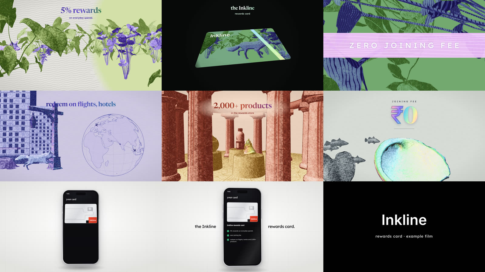

# Inkline

**A 30-second engraved 3D launch film, made from your script.**



Paste a product script, and Inkline storyboards it and builds a film of its own from a kit of engraved worlds
(the original card film below is one example of what it makes):
- engraved 3D worlds in two-ink duotones;
- a garden that turns into your card;
- a foil-strip close-up that splits open onto a travel globe;
- the globe becoming a colonnade floor;
- your key number rising from a shell like a pearl;
- a phone mockup where your claims tick on, and your logo at the end.

The music and sound effects are original, generated in code and timed to every cut.

Built with [Remotion](https://www.remotion.dev), [Three.js](https://threejs.org) and
[Claude Code](https://claude.com/claude-code). Free to use under the MIT licence; see **Licences** below for the
parts that have their own terms.

---

## Make a film (easiest: with Claude Code)

1. Open this repo in Claude Code, on the web (claude.ai/code), desktop or CLI. The setup hook installs everything
   on the first start. You should see `inkline ready: …`.
2. Paste:

   ```
   Make a film from this script using the inkline-film skill.
   Brand: <name>. Logo: <path to your logo PNG, or "none">.

   <your script>
   ```

3. Claude shows a **storyboard table**: which shot carries which claim. Approve it, or say what to move.
4. Claude sends **9 stills**. Check the words and the logo, then say "go".
5. Claude renders the film (about 30–40 minutes), checks it for freezes, and sends you the MP4.

## Make a film by hand

You need Node.js 22.18+, Python 3 with `numpy` and `pillow`, and ffmpeg.

```sh
git clone https://github.com/vikasbanjare/inkline-Motion-Graphic && cd inkline-Motion-Graphic
bash scripts/setup.sh                                    # installs packages, finds a browser, checks python/ffmpeg

cp specs/example.json specs/mine.json                    # then replace every value with your script's words
python3 tools/film.py specs/mine.json                    # checks every line fits its shot; prints the next commands
bash tools/render.sh public/films/mine/props.json out/mine.mp4   # render + score + motion check
```

To preview in the browser while you edit, run `npx remotion studio` and pick the `Film` composition.

## The storyboard: what each shot can say

| Time | Shot | Field in your sheet | Best for | Limit |
|---|---|---|---|---|
| 0–6 s | Pen lines race in, a garden grows, a fox walks | `claim1` | your lead benefit (rewards, cashback) | 26 chars |
| 6–8 s | The garden becomes your card's print | `card` | the product's name | 30 |
| 8–11 s | Push into the foil strip; one phrase lands whole | `strip` | your sharpest short claim, in CAPITALS | 18 |
| 11–16 s | The strip splits open onto a travel world and globe | `claim2` | travel, redeem, worldwide | 30 |
| 16–20 s | The globe becomes a colonnade; products drop onto plinths | `claim3` | choice, store, partners | 26 |
| 20–23 s | A shell in the deep; your number rises from it | `hero` | one number: a fee, a rate, a limit | 5 |
| 23–27 s | The card drops into a phone; your claims tick on | `outro` | the full claim list | 64 per row |
| 27–30 s | Your logo on black | `logo`, `lockup` | the product line | 40 |

`tools/film.py` rejects anything too long and tells you which line to shorten.

## Your logo

Put your logo in `public/brand/` as a **white logo on a transparent PNG**, and set `"logo": "brand/your-logo.png"`
in your sheet. With no logo file, the name is set in plain type.

Use only a logo you have the right to use. Don't put another company's logo or name in your film.

## Two ways to make a film

**A unique film (the `Story` composition): the default.** Claude reads your script as a storyboard designer
would. It finds the story's spine and picks a shape (journey, problem → turn, place, ritual, proof stack). It casts
each beat as a metaphor in one of the kit's worlds and joins them with transitions that mean something. The look
stays the same in every film: engraved 3D, two-ink worlds, foil and serif headlines. The order, worlds, cast,
timing and score come from your script.

| Worlds (src/kit/worlds/) | Best for |
|---|---|
| garden | origin, growth, nature, a beginning |
| globe | reach, sourcing, travel, a network |
| orbit | a process that turns: roasting, an engine, AI, a platform |
| table | how it's made: food and drink, craft, a ritual in close-up |
| city | a store or venue opening: a street grows, a person walks in, the door opens |
| hall | a curated range, a store interior, choice |
| deep | the one number, rising like a pearl |
| type | a belief in words, one in foil |
| object | the world you just watched becomes the print on a card, ticket, banknote or screen |
| stage | a phone shows your claims |
| lockup | your logo |

Transitions: `lines` (the pen-line opening), `iris`, `match` (one world becomes the next), `cut` (a scale step on
the beat), `wipe` (a foil-edged diagonal), `print`, `split` (a foil strip opens), `dive`.

```sh
python3 tools/plan.py specs/coffee.plan.json        # checks the storyboard, snaps cuts to the beat, writes the score
bash tools/stills.sh public/films/velmora/props.json out/velmora-stills 85,209,310,417,539,645
bash tools/render.sh public/films/velmora/props.json out/velmora.mp4
```

`specs/coffee.plan.json` is a worked example: a store launch for **Velmora**, a fictional coffee brand. The
director's method is in `.claude/skills/inkline-film/reference/storyboarding.md`.

**The fixed template (the `Film` composition).** The original 30-second card film; only the words, the number and
the logo change (`tools/film.py`, the table above).

## Licences and credits

- **Code** in this repo: MIT (see `LICENSE`).
- **Remotion** has its own licence. It is free for individuals and for companies of up to 3 people; larger
  companies need a company licence. Check [remotion.dev/license](https://www.remotion.dev/license) before
  using this for client work.
- **3D models:** Khronos glTF sample assets, CC0 and CC-BY 4.0. **Credit the CC-BY authors when you publish a
  film.** The list is in `public/models/CREDITS.md`.
- **Fonts:** Newsreader and Lexend, SIL Open Font License (`public/fonts/OFL-LICENSES.txt`).
- **Map data:** Natural Earth via `world-atlas` (public domain).
- **Music and SFX:** generated by `tools/score_to_picture.py`. Every note is synthesized, so you can use it freely.

**Your claims are your responsibility.** Put only true, approved claims in a film.
