# Two journeys, one cup

*Fictional brand and claims: a sample film to show the kit. Not a real company.*

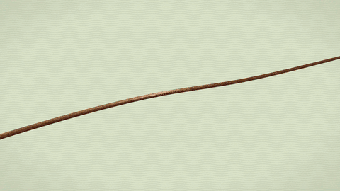

**[Watch the film (film.mp4)](film.mp4)** · 36.7 s · 12 shots

- **Logline:** A man walking to work and a coffee bean travelling from the hills cross the city before sunrise, and meet in one cup at Velmora's new café.
- **Device:** Parallel journeys: bean / man intercut, shots shortening as they converge, then one slow payoff.
- **Motif:** Circles and steam: the drop, the cherry, the drum, the tray, the lamps, the cup.
- **Protagonist:** A man in an ochre coat and a dark fedora, always walking left to right.
- **Arc:** A blue, sleepy city → the café's door opens on warm light → the first cup as the sun reaches the street.

## The board

### 01 · Hook + set-up · A · 0.0–5.7 s

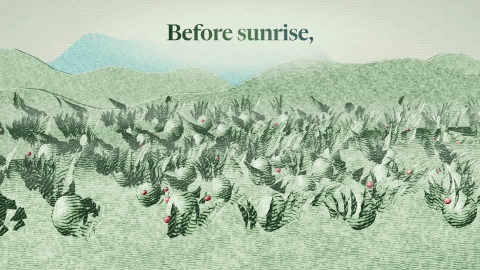

**Shot:** EWS · eye level · crane down  
**Action:** A drop of coffee falls onto the paper and blooms open into coffee hills at first light: ridges in mist, rows of shrubs heavy with cherries.  
**Words:** “Before sunrise,”  
**Sound:** The drop's tick; wind; far birds; one Rhodes chord.  
**In:** Bloom opener  
**Why:** Open on the motif (a circle) and the origin.

### 02 · Set-up · A · 5.7–8.9 s

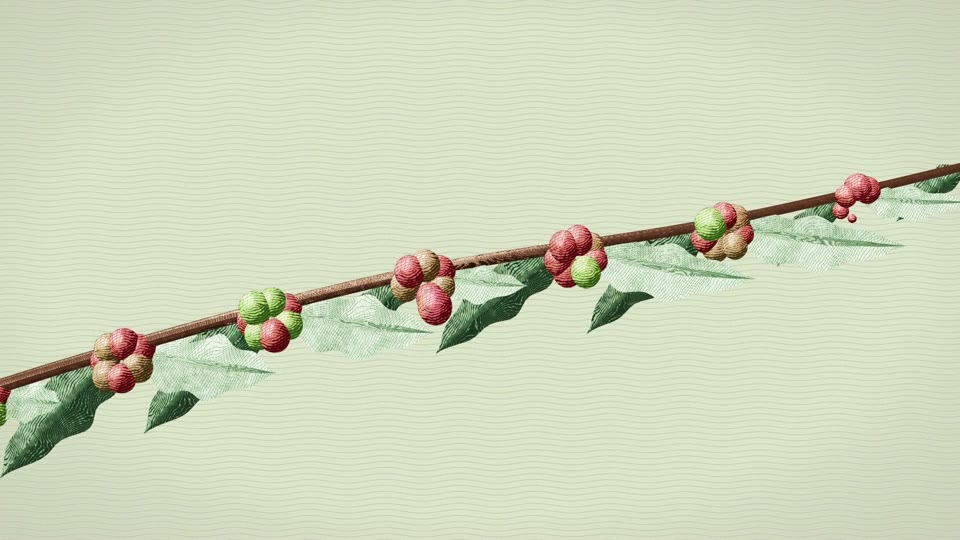

**Shot:** CU · slow push  
**Action:** On one branch a cherry ripens from green to red, then lets go and falls right.  
**Sound:** Leaf rustle; birds.  
**In:** Cut on the beat  
**Why:** The bean's journey starts; its fall hands over to his first step.

### 03 · Set-up · B · 8.9–12.1 s

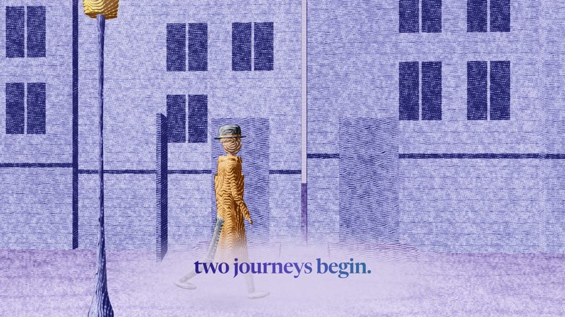

**Shot:** WS · static, then he moves  
**Action:** A blue-hour street. His door swings open; the man in the ochre coat steps out and sets off left to right.  
**Words:** “two journeys begin.”  
**Sound:** Door latch; city; his footsteps begin, in time. Brushes enter.  
**In:** Match on motion (the cherry falls right, he steps right)  
**Why:** Our protagonist, introduced in one action.

### 04 · Journey · A · 12.1–15.0 s

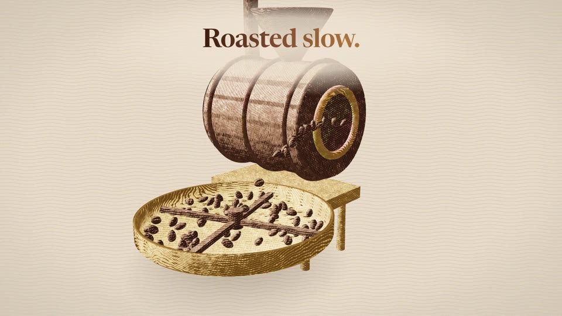

**Shot:** MS → TOP · orbit, then a scale-step  
**Action:** The drum roaster turns and pours its beans into the cooling tray; the arms sweep them round.  
**Words:** “Roasted slow.”  
**Sound:** Drum hum and bean rattle; a soft air on the wipe.  
**In:** Foil wipe  
**Why:** Transformation: the bean is roasted.

### 05 · Journey · B · 15.0–17.5 s

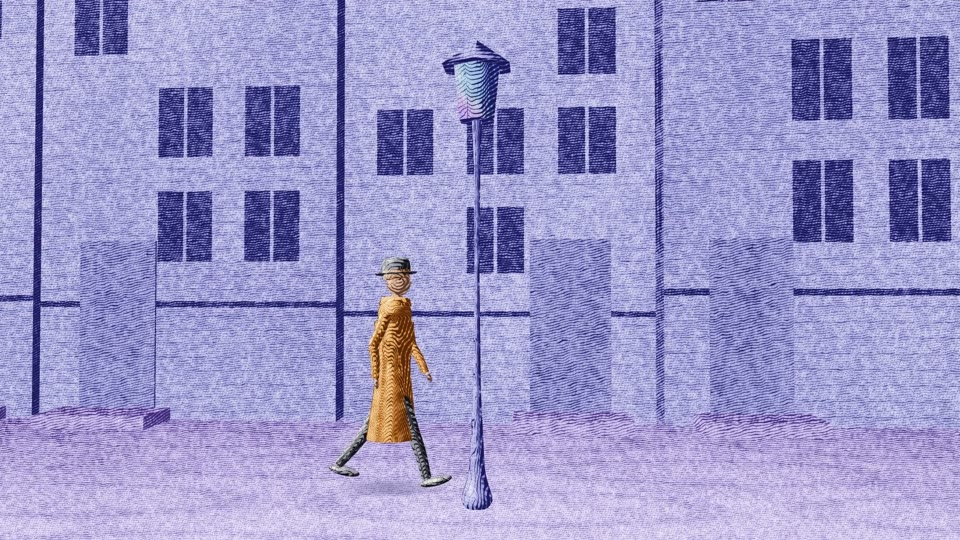

**Shot:** WS · tracking right with him  
**Action:** He walks past the terraces; behind him the street lamps go out one by one as the sky warms; a vent breathes steam.  
**Sound:** Footsteps panning with him; a click as each lamp goes out; steam hiss.  
**In:** Match (the tray's circle → the round lamps)  
**Why:** Time passes: night turns to morning.

### 06 · Journey · A · 17.5–20.4 s

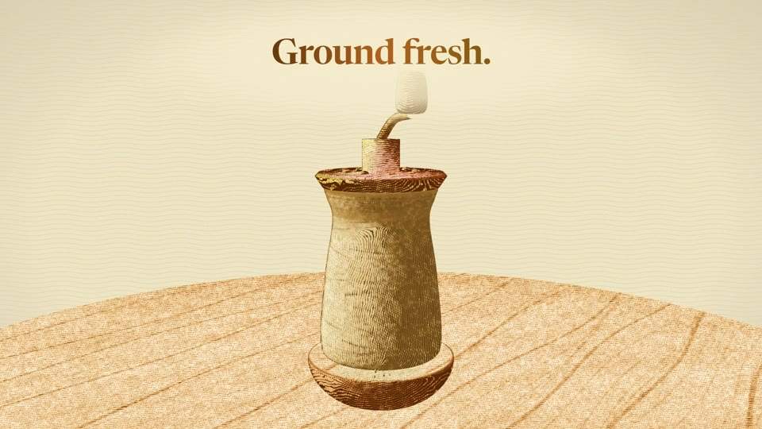

**Shot:** TOP → three-quarter  
**Action:** Over the grinder's mouth, the crank turns; grounds fall into the bowl.  
**Words:** “Ground fresh.”  
**Sound:** The grinder's crunch, pulsing with the crank.  
**In:** Cut on the beat  
**Why:** Craft, close and tactile.

### 07 · Journey · B · 20.4–22.5 s

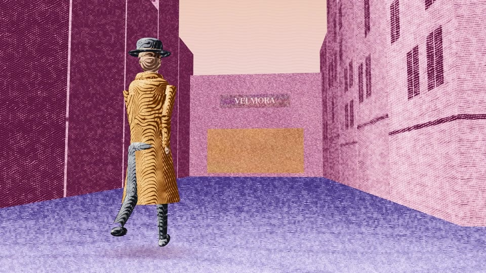

**Shot:** Low angle · static  
**Action:** He turns into a side street. At the far end, VELMORA's sign flickers on.  
**Sound:** Steps slow; the sign's soft electric hum.  
**In:** Cut on his turn  
**Why:** The destination appears.

### 08 · Converge · A · 22.5–25.4 s

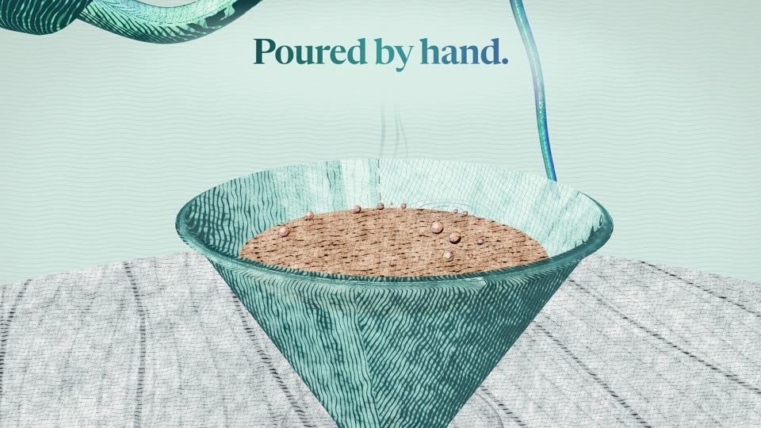

**Shot:** WS → CU · push into the stream  
**Action:** A gooseneck kettle circles over the dripper: the stream arcs in, the bed blooms and bubbles, drips fill the carafe.  
**Words:** “Poured by hand.”  
**Sound:** The pour; drips; steam. The music is at its fullest.  
**In:** Match (the sign's glow → the kettle's shine)  
**Why:** The two journeys are about to meet.

### 09 · Turn · 25.4–27.9 s

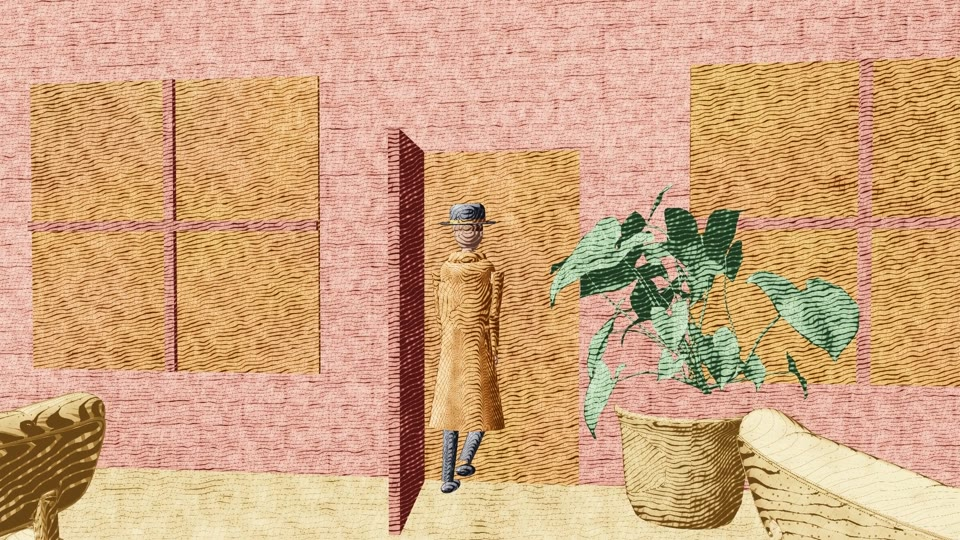

**Shot:** MS · push in  
**Action:** The café door opens on warm light. He steps in.  
**Sound:** Door; the shop bell. Then near-silence: one held chord.  
**In:** Cut on the door  
**Why:** The turn: he arrives.

### 10 · Payoff · 27.9–30.4 s

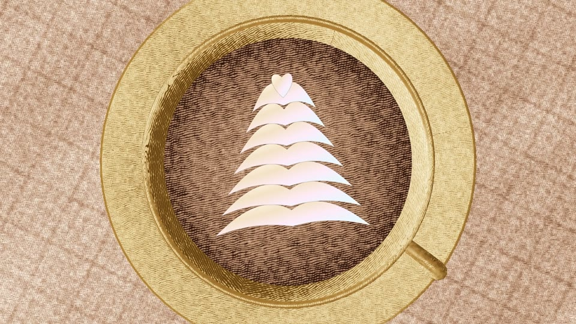

**Shot:** TOP · slow rotate  
**Action:** From above, a rosetta draws itself into the crema.  
**Sound:** A reverse swell; the milk pour; café murmur.  
**In:** Dive into the warmth  
**Why:** They meet: the bean becomes his cup.

### 11 · Payoff · 30.4–33.6 s

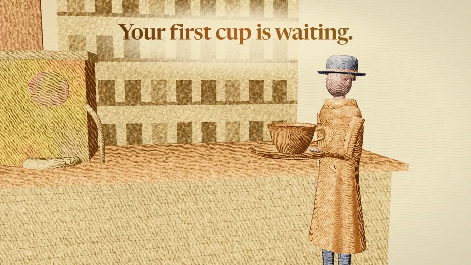

**Shot:** MS · slow dolly  
**Action:** At the counter, he lifts the cup; steam curls up into the morning light.  
**Words:** “Your first cup is waiting.”  
**Sound:** Café murmur; the cup leaves the saucer; the music lands.  
**In:** Match (the cup from above → the cup on the counter)  
**Why:** The feeling the brand gives.

### 12 · End card · 33.6–36.7 s

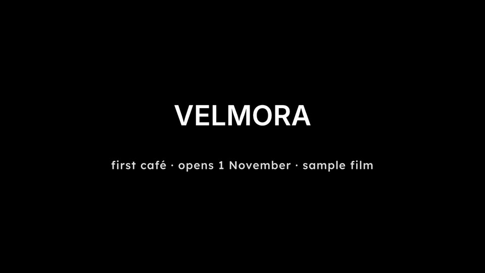

**Shot:** Lockup  
**Action:** The VELMORA wordmark; first café; opens 1 November.  
**Sound:** A last clink; the chord's tail.  
**In:** Cut  
**Why:** The action, and the label: a fictional sample.

---

Made with Inkline: storyboarded by Claude from the brief, built as engraved 3D scenes (`src/films/velmora/`), cut to the beat with an original synthesized score. Plan: `specs/coffee.plan.json`.
